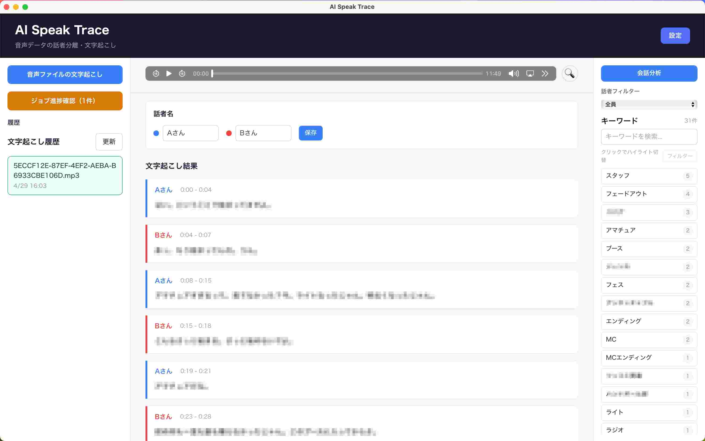

# AI Speak Trace

音声データから話者分離・文字起こしを行い、会話内容をキーワード分析・Web検索付きで深掘りできるデスクトップアプリケーションです。



## クイックスタート

### 1. インストール

[GitHub Releases](https://github.com/saicologic/ai-speak-trace/releases/latest) から最新版をダウンロードしてください。

**dmgファイルの場合（推奨）**

1. `.dmg` ファイルをダブルクリック
2. 開いたウィンドウでアプリを `Applications` フォルダにドラッグ&ドロップ
3. Launchpadまたは `Applications` フォルダからアプリを起動

**tar.gzファイルの場合**

1. ターミナルで以下を実行してインストール:

```bash
# ダウンロードしたファイルを展開してApplicationsフォルダに配置
tar xzf ~/Downloads/AI.Speak.Trace_*.app.tar.gz -C /Applications
```

2. Launchpadまたは `Applications` フォルダからアプリを起動

### 2. 初期設定

アプリ右上の `設定` ボタンから、使う機能に合わせて設定してください。保存後すぐに反映されるため、アプリの再起動は不要です。

| 設定画面の項目 | 使える機能 | 必要な設定 | 取得先 |
|---|---|---|---|
| 文字起こし | 文字起こし・結果の表示・キーワード | ElevenLabs の API キー | https://elevenlabs.io/app/developers/api-keys |
| AI 分析（Claude と AWS） | 要約・会話分析・発言の文脈・ディープサーチ | 「AI 分析を使う」を ON ＋ Anthropic の API キー ＋ Amazon Bedrock Guardrails（Guardrail ID・AWS プロファイル） | https://console.anthropic.com ・ AWS のコンソール（Bedrock の Guardrails） |
| キーワード | GiNZA のキーワード抽出（ベータ） | なし（初めて使うときに GiNZA をダウンロード） | |

AI 分析は、Claude に送る前に Guardrails で個人情報やプロンプト攻撃を確認するため、AWS が必要です。要約・会話分析・発言の文脈・ディープサーチのボタンはいつも表示し、「AI 分析を使う」が OFF のときや、Anthropic の API キー・Guardrail ID が足りないときは押せない状態にします。右サイドバーのボタンの上に、使えるか・OFF か・足りない設定を表示します。OFF のときは、Claude にも AWS にも何も送りません。新しく入れたときは OFF です（以前のバージョンで API キーと Guardrail ID を設定していた場合は ON）。AWS の認証情報は、この Mac の `~/.aws`（設定画面の「AWS プロファイル」で指定したプロファイル）を使います。

#### ElevenLabs APIキーのアクセス制限

**アクセスが必要な項目:**

| スコープ | 設定 | 理由 |
|---|---|---|
| スピーチ to テキスト | アクセス | 音声の文字起こし・ステータス確認に必要 |
| ユーザー | 読み取り | クレジット残量確認に必要 |

上記以外のスコープ（テキスト読み上げ、サウンドエフェクト、ボイス等）は全て「アクセスなし」に設定してください。

### 3. 音声ファイルの準備

手持ちの音声ファイル（mp3, m4a, wav など）をそのまま使えます。

**Podcastアプリから取り込む場合**

macOSにはPodcastアプリがプリインストールされています。エピソードをダウンロードしてから、本アプリにアップロードしてください。

- [Podcastでエピソードを保存する/ダウンロードする（Mac）](https://support.apple.com/ja-jp/guide/podcasts/poda4f6be01/mac)
- [Podcastユーザガイド（Mac）](https://support.apple.com/ja-jp/guide/podcasts/welcome/mac)

> Podcastアプリが見つからない場合は、[App Store](https://apps.apple.com/jp/app/apple-podcasts/id525463029) から再インストールできます。

**ファイルの場所**

| 種類 | パス |
|---|---|
| Podcast音声のキャッシュ | `~/Library/Group Containers/243LU875E5.groups.com.apple.podcasts/Library/Cache` |
| アプリのデータ保存先 | `~/Library/Application Support/io.github.saicologic.ai-speak-trace/data` |

ターミナルでアクセスする場合（スペースをエスケープ）:

```bash
# Podcast音声のキャッシュ
open ~/Library/Group\ Containers/243LU875E5.groups.com.apple.podcasts/Library/Cache

# アプリのデータ保存先
open ~/Library/Application\ Support/io.github.saicologic.ai-speak-trace/data
```

### 4. 使い方

セットアップが完了したら、[使い方](#使い方)に進んでください。

---

## 使い方

### 1. ファイルアップロード・文字起こし・結果確認

1. 左サイドバーの「音声ファイルの文字起こし」をクリック
2. 音声ファイルを選択し、クレジット残量を確認して「文字起こしを実行」
3. 完了後、メイン画面に話者ごとに色分けされた文字起こし結果が表示される
4. 音声を再生・停止し、🔍ボタンで現在の再生位置に該当する発話へ自動スクロール
5. 発話のタイムスタンプや単語をクリックすると、その位置から音声を再生

### 2. 話者フィルター

1. 右サイドバーの「話者フィルター」で話者を選択
2. その話者の発話のみに絞り込み表示し、キーワード一覧もその話者の発話から抽出したものに切り替わる（「全員」に戻すと会話全体のキーワードに戻る）
3. フィルター中に発話をクリックすると、直前の別話者の発話をポップアップ表示

### 3. キーワードフィルター

1. 右サイドバーに専門用語・固有名詞が自動抽出されたキーワード一覧が表示される（「キーワードを検索」で一覧を絞り込める）
2. キーワードをクリックするとハイライト表示
3. 「フィルター」ボタンで選択キーワードを含む発話のみに絞り込み
4. 設定画面の「キーワード」で「GiNZA のキーワード抽出」を有効にすると、一覧の上で「標準」と「GiNZA」を切り替えられる（下の「ベータ版の機能」を参照）

### 4. 会話分析

「AI 分析を使う」が ON で、設定が済んでいる場合に使えます（以下の 5・6 も同じ）。

1. 「会話分析」ボタンで会話分析ページに遷移
2. 話者を選択するとその話者のキーワードが表示される（GiNZA のキーワード抽出が有効な場合は「標準」と「GiNZA」を切り替えられる）
3. キーワードを選択して「質問を生成」→ チェックボックスで質問を選択 →「分析する」で実行
4. [Claude API](https://docs.anthropic.com/ja/docs/welcome)がWeb検索付きの分析レポートを生成し、出典URLも表示

### 5. ディープサーチ

- 左サイドバーの「ディープサーチ」から、選んだ会話のキーワードを提案し、Web検索で調査
- 調査結果を[Claude API](https://docs.anthropic.com/ja/docs/welcome)で統合分析

### 6. 発言の文脈

- 右サイドバーの「発言の文脈」を押し、文字起こし結果から発言を複数選択して文脈を分析
- 各発言の意図・トピックを[Claude API](https://docs.anthropic.com/ja/docs/welcome)で解析

### 7. ベータ版の機能

設定画面の「キーワード」から有効化できます（デフォルトは無効）。AWS も Claude も使いません。

**GiNZA のキーワード抽出**
- 右サイドバーのキーワード一覧と会話分析で、キーワードの抽出方法を「標準」と「GiNZA」で切り替えられる。選んだ方法は会話ごとに保存される
  - 標準: カタカナ語・英字の語を正規表現で抽出する
  - GiNZA: 日本語を解析する[GiNZA](https://megagonlabs.github.io/ginza/)で名詞のまとまりを取り出す。標準では取れない漢字だけの語（評価・型チェックなど）も抽出できる。回数の多い順に並べ、人名・すべての会話に出てくる語・会話によく出てくる一般的な語は除く
- 漢字の語が中心の会話では GiNZA、カタカナ語・英字の語が中心の会話（技術系の Podcast など）では標準が見やすいことが多い
- 初めて「GiNZA」を選んだときに「GiNZA を入れる」を押すと、Python 3.12 と GiNZA（約 500MB）をダウンロードして `~/Library/Application Support/io.github.saicologic.ai-speak-trace/ginza/` に入れる（1分ほどかかる）。DMG には含まれない
- 解析はこの Mac の中で行い、会話を外部に送らない。macOS（Apple シリコン）で動作確認している

---

## プライバシーとAIの利用

このアプリは、会話の音声や文字起こしを外部のAIサービス（ElevenLabs・Anthropic・AWS）に送って処理します（GiNZA のキーワード抽出は、この Mac の中だけで処理します）。
送信するデータ、保存先、削除方法、録音される人の同意、AIが生成する内容の扱いは [PRIVACY.md](PRIVACY.md) を確認してください。

## データの保存先

文字起こし結果やアップロードした音声ファイルは以下に保存されます:

```
~/Library/Application Support/io.github.saicologic.ai-speak-trace/data/
├── audio/            # 音声ファイル
├── transcriptions/   # 文字起こし結果
├── chunks/           # チャンク分割された音声ファイル（処理中のみ）
├── chunked-jobs/     # チャンク分割ジョブの状態
└── ginza-keywords/   # GiNZA で抽出したキーワード（会話ごと。文字起こしを削除すると一緒に削除）
```

GiNZA のキーワード抽出（ベータ機能）で入れた Python と GiNZA は、`data/` と同じ階層の `ginza/` に保存されます。ほかのフォルダの一覧は [PRIVACY.md](PRIVACY.md) の「端末に保存するデータ」を確認してください。

## トラブルシューティング

| 症状 | 原因と対処 |
|---|---|
| 文字起こしが中断・失敗した | 左サイドバーの「中断中のジョブ」→ 対象ジョブを選択 →「途中から再開する」をクリック。完了済みチャンクはスキップされます |
| 起動直後に「サーバーに接続できません」と表示される | バックエンドの起動待ち中です。自動リトライされるので数秒お待ちください |
| 文字起こしが実行できない | 設定画面でElevenLabs APIキーが正しく設定されているか確認してください |
| 要約・会話分析・ディープサーチのボタンを押せない | 右サイドバーのボタンの上に理由が表示されます。設定画面の「AI 分析（Claude と AWS）」で「AI 分析を使う」を ON にし、Anthropic の API キーと Guardrail ID を設定してください |
| 「AWS の認証情報（プロファイル: 〇〇）が無効なため、Guardrails で確認できませんでした」と表示される | `aws sts get-caller-identity --profile 〇〇` で認証情報が使えるか確認し、設定画面の「AWS プロファイル」を Guardrail があるアカウントのプロファイルにしてください |
| 長時間音声の文字起こし中に「Load failed」と表示される | WebViewのコネクションタイムアウトです。バックエンドは処理を継続しているため、進捗画面で完了を待つか、「中断中のジョブ」から再開してください |
| 中断中のジョブが表示されない | 同じファイル名で完了済みの文字起こしがある場合、中断ジョブは自動的に非表示になります |
| キーワード一覧に「標準」「GiNZA」の切り替えが表示されない | 設定画面の「キーワード」で「GiNZA のキーワード抽出を有効にする（ベータ）」にチェックを入れて保存してください |
| GiNZA を入れられなかった | インターネットに接続できるか確認し、「もう一度入れる」を押してください。うまくいかない場合は、アプリを終了して `~/Library/Application Support/io.github.saicologic.ai-speak-trace/ginza/` を削除してから入れ直してください |

## 開発者向け

[開発者ガイド](docs/developers/)

### AI に動作確認を頼む

CI とコードレビューでは確かめられない動作（画面の操作・DMG のアプリなど）は、[Claude Code](https://docs.anthropic.com/ja/docs/claude-code/overview) に頼むと、AI が画面を操作して確かめます。AI で確かめられる項目は、PR に「## 自動テスト項目」として、確かめる内容を含めた AI への依頼文だけを書きます。

**依頼のしかた**

PR の「自動テスト項目」に書かれた依頼文を、Claude Code にそのまま渡します。確かめる場所は次の2つです。

| 確かめる場所 | AI が使うもの | 向いている確認 |
|---|---|---|
| 開発用の画面（ブラウザ） | Playwright | 画面の表示・操作、バックエンドの API |
| DMG で入れたアプリ | computer-use（デスクトップの画面操作） | サイドカー・DMG・アプリの再起動が関わる動作 |

**PR に書く例**

````markdown
## 自動テスト項目

自動テストで行えます。次の依頼文を Claude Code に渡してください（README の「AI に動作確認を頼む」を参照）。

```
DMG を作って入れたアプリの画面で、次を確かめて。
- 設定の「〇〇を有効にする」が最初はオフで、オフのときは〇〇が出ない
- 〇〇を押すと、〇〇が表示される
```
````

**気をつけること**

- 外部の API に送る操作（文字起こし・要約・会話分析など）と、元に戻せない操作（文字起こしの削除など）は、AI が実行する前に確認を求めます。確かめに使う会話も、そのときに指定してください
- AI がアプリを操作している間は、アプリのウィンドウを手前に出したまま、パソコンを操作しないでください。ウィンドウが手前にないと、AI の操作が止まります
- AI は、確かめられた項目と確かめられなかった項目を分けて報告します。確かめられなかった項目は、自分で確かめるか、依頼し直してください

---

## ライセンス

[MIT License](LICENSE)
