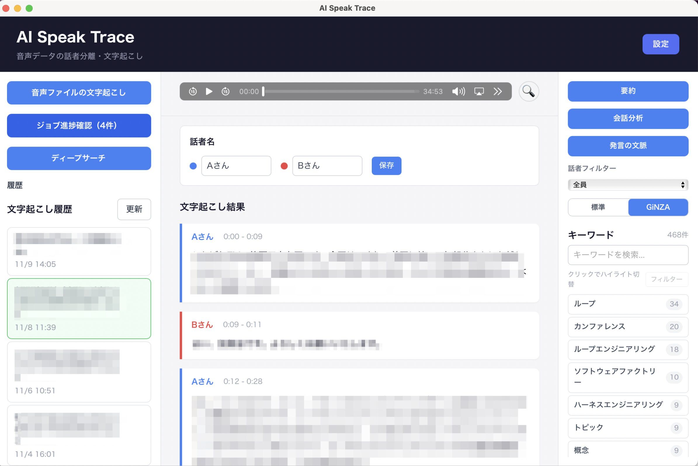

# AI Speak Trace

音声データから話者分離・文字起こしを行い、会話内容をキーワード分析・Web検索付きで深掘りできる macOS のデスクトップアプリケーションです。

## できること

- 話者分離と日本語の文字起こし（ElevenLabs Scribe v2）
  - macOS の Podcast アプリでダウンロードしたエピソードも、そのまま文字起こしできます
  - 話者名（最初は「Aさん」「Bさん」）は後から変えられます
  - 止まった文字起こしは「ジョブ進捗確認」から途中で再開できます
- 音声の再生と、再生位置の発話への移動（発話や単語をクリックすると、その位置から再生）
- 話者・キーワードでの発話の絞り込み（キーワードの抽出は「標準」と「GiNZA（ベータ）」を切り替えられます）
- 要約・会話分析・発言の文脈（Claude API）
- ディープサーチ：会話に出てきた用語を、Web の公式情報で調べて解説（根拠を確認できなかった文は表示しません）
- 個人情報チェック：Claude に送る前に、会話の個人情報を伏せる（Amazon Bedrock Guardrails）
- 誤りを報告：AI の結果に誤りがあれば、この Mac にメモを残せます（外部には送りません）
- MCP サーバー：個人情報チェック済みの会話を、Claude Desktop・Claude Code から読み取り専用で検索・参照する（ソースコードからビルドして使う。[使い方](docs/users/usage.md#11-mcp-サーバーclaude-desktopclaude-code-から会話を読む)）

## 動作環境

- macOS（Apple シリコン）。配布する DMG は Apple シリコン（arm64）向けだけです
- 文字起こしだけなら、ElevenLabs の API キーがあれば使えます
- 要約・会話分析・発言の文脈・ディープサーチ（AI 分析）は、設定で「AI 分析を使う」を ON にし、Anthropic の API キーと AWS（Amazon Bedrock Guardrails）を設定すると使えます
- GiNZA のキーワード抽出（ベータ）は、初めて使うときに約 500MB をダウンロードします（DMG には含みません）

## はじめかた

1. [GitHub Releases](https://github.com/saicologic/ai-speak-trace/releases/latest) から最新版をダウンロードして入れる
2. アプリ右上の `設定` から API キーなどを設定する → [インストールと初期設定](docs/users/setup.md)
3. 音声ファイルを選んで文字起こしする → [使い方](docs/users/usage.md)

会話の音声や文字起こしは、外部のAIサービス（ElevenLabs・Anthropic・AWS）に送って処理します。使う前に [PRIVACY.md](PRIVACY.md) を確認してください。

## 安全のための仕組み

- 画面に出す AI の回答は無害にしてから表示し、CSP で読み込めるものを絞っています
- バックエンド（sidecar）の API は、アプリの画面からしか呼べません
- リリース版では Web インスペクタを開けません
- 保存先の外を指す ID・ファイル名では、読み書き・削除をしません

問題を見つけたときは [SECURITY.md](SECURITY.md) の手順で報告してください。

## ドキュメント

| 知りたいこと | ドキュメント |
|---|---|
| インストールと初期設定 | [docs/users/setup.md](docs/users/setup.md) |
| 各機能の使い方・データの保存先 | [docs/users/usage.md](docs/users/usage.md) |
| うまく動かないとき | [docs/users/troubleshooting.md](docs/users/troubleshooting.md) |
| 外部に送るデータ・保存するデータ・削除方法 | [PRIVACY.md](PRIVACY.md) |
| セキュリティ上の問題の報告 | [SECURITY.md](SECURITY.md) |
| 開発環境・ビルド・アーキテクチャ | [docs/developers/README.md](docs/developers/README.md) |
| macOS のコード署名・公証 | [docs/developers/code-signing.md](docs/developers/code-signing.md) |
| ディープサーチの仕組み | [docs/developers/deep-search.md](docs/developers/deep-search.md) |
| AI に動作確認を頼む | [docs/developers/ai-testing.md](docs/developers/ai-testing.md) |
| バックエンド・フロントエンド | [backend/README.md](backend/README.md)・[frontend/README.md](frontend/README.md) |

## 検討中

まだ決まっていない設計の話し合いです。決まったものは、`docs/developers/` に正式なドキュメントとして残します。

| 内容 | ドキュメント |
|---|---|
| システム全体のアーキテクチャを、コンポーネントの分け方から見直す | [安定し続けるアーキテクチャ](https://claude.ai/artifact/WH9LjYNbWQkGHA3dYmYATy)（Claude の Artifact） |

## ライセンス

[MIT License](LICENSE)
