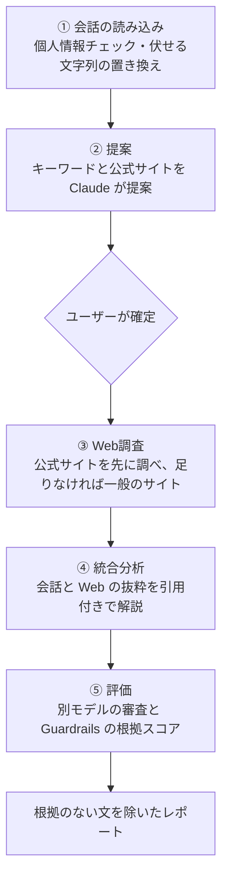

# ディープサーチの設計

ディープサーチは、文字起こしした会話に出てきた用語を Web で調べて解説する機能です。
公式サイトを先に調べ、情報が足りないときだけ一般のサイトも調べます。
会話での説明と Web の情報が食い違う箇所も示します。
AI の出力はそのまま使わず、文ごとの引用と別モデルの審査で確かめ、根拠のない文はレポートから除きます。
英語の文は、Amazon Bedrock Guardrails の根拠スコアでも確かめます（日本語の文は対象外）。

コードは `backend/src/research/` にあります。

## 処理の流れ

| 段階 | 使うもの | 主な処理 |
|---|---|---|
| ① 読み込み | `PrivacyService`・`TranscriptionStoreService` | Guardrail ID がなければ開始しない。個人情報チェックをしていない会話は検出する。合計30万文字まで |
| ② 提案 | `claude-sonnet-5-5` | キーワード・理由・会話からの引用・公式サイトを提案させる |
| ③ Web調査 | `claude-sonnet-5-5`＋`web_search_20250305` | キーワードごとに検索する（`max_uses` は最大3回） |
| ④ 統合分析 | `claude-sonnet-5-5`＋Citations | キーワードごとに「一言でいうと／詳しく／会話での説明との違い／関連するキーワード」を書かせる |
| ⑤ 評価 | `claude-haiku-5-5`・Bedrock Guardrails | 文ごとの裏付け・キーワードへの回答・AI倫理を判定する |

ジョブの状態は `proposing → awaiting_confirmation → researching → analyzing → evaluating → completed`（失敗したら `failed`）と進み、段階ごとに `ResearchJobStore` に保存します。

## 他の Deep Research との違い

Gemini と ChatGPT の Deep Research は、質問から AI が調査計画を立て、Web を広く調べてレポートを書く汎用の機能です。
ディープサーチは、会話を出発点に、決まった手順で狭く確かに調べることに絞っています。

| 観点 | ディープサーチ | Gemini・ChatGPT の Deep Research |
|---|---|---|
| 出発点 | 文字起こしした会話 | ユーザーの質問（ファイルやメールなども足せる） |
| 目的 | 会話に出た用語の理解と、会話での説明との食い違いの発見 | 質問への包括的なレポート |
| 計画 | 決まった5段階。調べるキーワードと公式サイトは人が確定する | AI が調査計画を立てる（Gemini は計画を見せて直させる） |
| 調べる範囲 | 公式サイトを優先し、検索回数を絞る | Web を広く調べる |
| 根拠の確かめ方 | 文ごとの引用を、別モデルと Guardrails で判定し、根拠のない文を除く | 引用と出典の一覧を示し、利用者が確かめる |
| 個人情報 | 送る前に検出して伏せる。会話に出る個人の推測を禁止する | 利用者にまかされる |

Gemini と ChatGPT の説明は、各社の公式の説明（2026年10月に確認）によります。

- [Gemini Deep Research](https://gemini.google/overview/deep-research/)・[Use Deep Research in Gemini Apps](https://support.google.com/gemini/answer/15719111?hl=en)
- [Introducing deep research](https://openai.com/index/introducing-deep-research/)・[Deep research in ChatGPT](https://help.openai.com/en/articles/10500283-deep-research-in-chatgpt)

## 設計の要点

### 1. 何重もの検証

AI の出力を、コード・別モデル・Guardrails の3つで確かめます。

- **作り話の引用をコードで捨てる**
  - `verifyQuotes` は、Claude が提案の根拠に挙げた引用が、実際の発言に含まれるかを文字列で確かめる。言い換えや作り話の引用は表示しない
  - 会話に1回も出てこないキーワードの提案も捨てる
- **文ごとに引用を付けさせる**
  - 統合分析では Citations を使い、会話は「1発言＝1ブロック」で渡す（`transcriptContentBlocks`）
  - 文字起こしは句点が少なく、全文を1つの文書で渡すと引用が会話全体になるため
- **書くモデルと審査するモデルを分ける**
  - 分析は `claude-sonnet-5-5`、審査は `claude-haiku-5-5`
  - 審査では、文に付いている根拠だけで判断させ、一般知識で補わせない（`judge`）
- **2つの判定を組み合わせて、除く文を決める**（`evaluate`）

| 文の種類 | 審査モデルの判定 | Guardrails の根拠スコア | 結果 |
|---|---|---|---|
| 引用がない事実の文 | ― | ― | 除く |
| 引用がある日本語の文 | 裏付けなし | （対象外） | 除く |
| 引用がある日本語の文 | 裏付けあり・一部 | （対象外） | 残す |
| 引用がある英語の文 | 裏付けなし | 0.8 未満 | 除く |
| 引用がある英語の文 | どちらか一方だけが「合わない」 | | 残して「要確認」にする |
| 引用がある英語の文 | 裏付けあり・一部 | 0.8 以上 | 残す |

- 見出し、「推測:」「不足:」と書いた文、関連するキーワードの列挙は、事実の文として審査しない
- 審査の結果が返らなかった事実の文は、裏付けを確かめられないため除く
- しきい値 `0.8` は、66件の主張（正しい主張と、事実を1か所変えた主張）で検証して、正解率が最も高かった（98%）値（`GROUNDING_THRESHOLD`）
- 評価として、引用が付いた文の割合（`citationCoverage`）、裏付けがあった割合（`supportedRate`）、公式サイトの出典の割合（`officialSourceRate`）を返す
- 除いた文（`removedClaims`）と「要確認」の文（`reviewClaims`）は、理由と一緒に評価に残し、ディープサーチの画面で確かめられるようにする
  - 調査ジョブはアプリのデータフォルダの `research-jobs/<調査ID>.json` に保存し、外には送らない。使った会話を削除すると、調査ジョブも一緒に削除する
  - レポートと除いた文は、伏せた後の会話から作るため、伏せた文字列を含まない。ただし、送る前のチェックの記録（`preSendChecks`）には、伏せた文字列と、要確認のまま送った文字列そのものが残る

### 2. プライバシーと安全をコードで強制する

プロンプトで頼むだけでなく、条件を満たさなければ処理を進めません。

- Guardrail ID が設定されていなければ、調査を始めない（失敗した調査も残さない）
- 個人情報チェックをしていない会話は、送る前に検出する。検出に失敗したら調査を始めない（`scanUnchecked`）
- 個人情報チェックで「伏せる」と選んだ文字列は、置き換えてから読み込む（`findForSending`）
- 画面の頻出語は伏せる前の会話から数えているため、伏せた後の会話に出てこない語は送らない（`sendableWords`）
- 何を伏せ、何を伏せずに送ったかを、調査を始めた時点で記録する（`privacyChecks`）
- Claude への送受信は、すべて `ClaudeClientService` を通り、送る前と受け取った後の両方を Guardrails で確かめる
  - ディープサーチでは、送る内容の全体を外から来た内容として確かめ、プロンプト攻撃も検出する
  - 応答の伏せられない部分（思考・検索語・検索結果の題名）に個人情報があれば、応答を使わない
- 審査では、会話に登場する個人の性格・健康・思想を推測していないか、個人を評価・選別する記述がないかも判定する
- 統合分析の出力も Guardrails で確かめ、連絡先などの個人情報・不適切な表現を AI倫理の項目として表示する

### 3. 出典の質

- キーワードごとに、まず選んだ公式サイトだけ（`allowed_domains`）を調べる。抜粋が500文字未満、または定義がわからなかったときだけ、一般のサイトも調べる（`researchKeyword`・`needsGeneralSearch`）
- 公式サイトだけで定義がわかったかは、Claude に「定義: あり／なし」と最後の行に書かせて判断する
- `allowed_domains` を指定しても、ほかのサイトの検索結果が返ることがある。そのため、選んだサイトの結果だけをコードで残す。ほかのサイトの結果が混ざったときは「定義: あり」を使わない
- 一般のサイトの検索に失敗しても、公式サイトの抜粋があれば、それだけで続ける

### 4. 長い処理の堅牢さ

- アプリの再起動で中断した調査は、起動時に失敗として記録し直す（`onModuleInit`）
- 調査の途中で会話が削除されたら、結果を保存せずに止める（`ResearchJobDeletedError`）。消した会話の内容が、調査の結果として残らないようにするため
- 一部のキーワードの Web調査に失敗しても、残りで続け、失敗を `webResearchFailures` に記録する
- 同じ調査を二重に確定させない（`confirming`）。調査の途中でタイトルを変えても、古い内容で上書きしない
- `pause_turn` で止まった Web調査は、最大3回まで再開する
- 会話にキャッシュの指定（`cache_control`）を付け、送る量の多い会話の費用を抑える

## 限界

- 今の実装は、Guardrails の根拠の確認を英語の文だけに使い、日本語の文は審査モデルの判定だけで扱う。根拠の確認の対応言語は tier によって違う（Classic tier は英語・フランス語・スペイン語）
- Guardrails の単語フィルターは日本語に対応していないため、出力の英語の部分だけを確かめる
- 調べる範囲を意図して狭くしているため、テーマを広く網羅する調査には向かない

## 用語集

| 用語 | 説明 | このアプリでの使い方 |
|---|---|---|
| Citations（引用） | Claude API の機能。渡した文書のどの部分を根拠にしたかを、回答の文ごとに返す（[Citations](https://platform.claude.com/docs/en/build-with-claude/citations)） | 統合分析で、会話の発言と Web の抜粋を引用させる |
| LLM-as-a-Judge | AI の出力の良し悪しを、別の AI に判定させる評価の方法 | 分析とは別のモデル（`claude-haiku-5-5`）が、文ごとの裏付けを判定する |
| Amazon Bedrock Guardrails | AWS のサービス。個人情報・不適切な表現・プロンプト攻撃の検出と、根拠の確認を行う（[Amazon Bedrock Guardrails](https://docs.aws.amazon.com/bedrock/latest/userguide/guardrails.html)） | Claude への送受信の確認と、統合分析の根拠スコアに使う |
| 根拠スコア（contextual grounding check） | Guardrails の機能。回答が渡した根拠の文章に沿っているかを点数で返す。対応する言語は tier によって違う（[contextual grounding check](https://docs.aws.amazon.com/bedrock/latest/userguide/guardrails-contextual-grounding-check.html)） | 英語の文だけを対象にし、しきい値 `0.8` 未満を「根拠と合わない」とする |
| プロンプト攻撃 | 文章に紛れ込ませた指示で、AI に意図しない動きをさせる攻撃。プロンプトインジェクションとも呼ぶ（[prompt attacks](https://docs.aws.amazon.com/bedrock/latest/userguide/guardrails-prompt-attack.html)） | Claude に送る内容を Guardrails で確かめ、検出したら送らない |
| 伏せる（マスク）・要確認 | 個人情報チェックで、Claude に送る前に置き換える文字列と、伏せるかどうかを人が決める候補 | 伏せる文字列は置き換えてから送る。要確認のまま送った文字列は記録に残す |
| `web_search` ツール | Claude API のサーバー側のツール。Claude が自分で Web を検索し、結果を引用付きで返す（[Web search tool](https://platform.claude.com/docs/en/agents-and-tools/tool-use/web-search-tool)） | Web調査で、キーワードごとに検索させる |
| `allowed_domains` | `web_search` の検索先を、指定したサイトに絞る設定 | 選んだ公式サイトだけを調べるときに使う |
| `max_uses` | 1回の呼び出しで検索できる回数の上限 | キーワード1つにつき最大3回 |
| `pause_turn` | 時間のかかるサーバー側のツールの途中で、Claude が応答をいったん返したことを示す値。同じ会話を送り直すと続きから再開する | Web調査で最大3回まで再開する |
| プロンプトキャッシュ（`cache_control`） | 同じ内容を続けて送るとき、2回目以降を安く速く処理する Claude API の機能（[Prompt caching](https://platform.claude.com/docs/en/build-with-claude/prompt-caching)） | 会話の文書に付け、提案と統合分析で同じ会話を送る費用を抑える |

## コードの対応表

| ファイル | 役割 |
|---|---|
| `backend/src/research/research.service.ts` | 段階の進行、ジョブの保存、`evaluate`（除く文の判定） |
| `backend/src/research/research-claude.service.ts` | 各段階の Claude の呼び出し（提案・Web調査・統合分析・審査） |
| `backend/src/research/research-guardrails.ts` | 根拠スコアのしきい値、Guardrails の出力の確認 |
| `backend/src/research/research.utils.ts` | 引用の確かめ（`verifyQuotes`）、公式サイトの判定、一般のサイトを調べるかの判断 |
| `backend/src/research/research-job.store.ts` | 調査ジョブの保存 |
| `backend/src/claude/claude-client.service.ts` | Claude への送受信と Guardrails の確認 |
| `frontend/src/components/ResearchPage.tsx` | ディープサーチの画面 |
